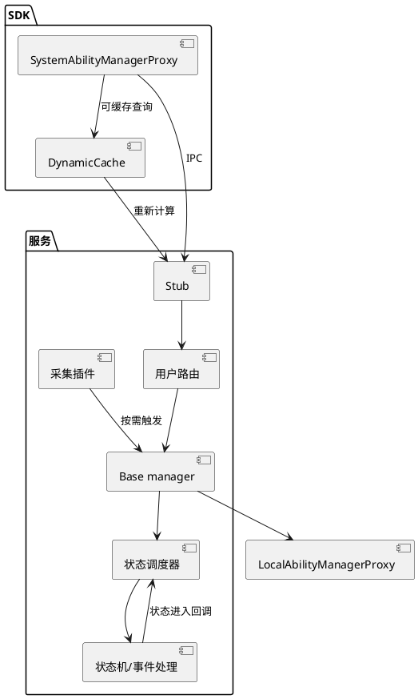

# 架构设计及约束

## 架构设计

### 设计原则

| 原则 | 描述 | 理由 |
|---|---|---|
| 客户端与服务分离 | Proxy封装交易；Stub校验分发；manager实施语义 | 参数校验、IPC失败和业务失败有不同返回边界 |
| 共享机制与用户路由分离 | Base实现公共表和生命周期；SystemAbilityManager按用户选择实例 | 复用机制但隔离用户状态 |
| 配置驱动和事件驱动 | Profile派生manager、调度与采集模型 | 描述能力与启动条件，避免每个SA写专用代码 |
| SA与进程状态分离 | 一个进程可能容纳多个SA，分别维护上下文 | 已启动进程不代表所有SA已加载；卸载一个SA不总是停止进程 |
| 生命周期和观测协作 | 注册、超时、死亡关联通知、缓存和DFX | 单个返回值无法代表整个异步操作已完成 |

### 逻辑架构

| 层/模块 | 源码目录 | 职责与关键对象 |
|---|---|---|
| 接口与共享模型 | interfaces/innerkits/samgr_proxy/include、common/include | 接口、IPC码、ID、回调、profile与错误码 |
| 客户端实现 | frameworks/native/source | Proxy、客户端回调Stub、参数封包和查询路径 |
| 服务入口与公共管理 | services/samgr/native/source | main、Stub、SystemAbilityManager、Base及死亡处理 |
| 状态与事件 | services/samgr/native/source/schedule、collect | 状态守卫、延迟事件、采集器插件 |
| 进程内反向代理 | services/lsamgr | samgr向SA进程发Start/Stop/Idle/Active及扩展请求 |
| 配置解析 | services/common/src | ParseUtil解析JSON，提供完整/派生profile |
| 多用户 | multi_system_ability_manager.cpp、user_lifecycle_manager.cpp | 激活、路由、停止和全用户订阅协作 |
| 缓存与绑定 | interfaces/innerkits/dynamic_cache、rust | 客户端缓存、Rust接口和C++桥接 |
| 诊断与启动配置 | services/dfx、etc | HiSysEvent、XCollie、启动配置和参数 |

所有目录均从仓根解析；表中仅给文件名的多用户实现位于 `services/samgr/native/source/`。当前Stub位于该目录，根AGENTS把Proxy/Stub并列在frameworks的导航不能当准确文件路径。

启动链是main→manager.Init→SetContextObject→AddSamgrToAbilityMap→写ready参数→启动DFX计时→JoinWorkThread。Base.Init先建立死亡监听和FFRTHandler、采集manager与调度器，再初始化profile。源码：`services/samgr/native/source/main.cpp` 中的 `main`、`services/samgr/native/source/base_system_ability_manager.cpp` 中的 `BaseSystemAbilityManager::Init`
。ready参数是一个启动观测，不是所有初始化分支成功的充分证明。

### 非功能设计

| 场景类别 | 方案设计 |
|---|---|
| 并发一致性 | abilityMap_使用shared_mutex；listener表、加载表、进程表等分别有锁；不能把整个samgr理解为单队列无锁模型 |
| 异步资源回收 | 加载通知、超时任务与死亡通知协同处理callback及PID计数；需考虑迟到事件和投递失败 |
| 多用户退出 | 从可路由集合移出后再完成停止、事件解除与Destroy，避免新请求继续进入停止manager |
| 权限及协议 | Stub统一令牌检查，具体交易执行授权与参数校验；条件编译影响权限与行为 |
| 观测 | HiSysEvent适配、trace、XCollie及dumper解释运行状态；阈值与功能依编译/配置而定 |
| 配置/兼容 | ID/IPC码、profile字段、Rust常量及跨仓消费者需同步评估 |

构建入口：`services/samgr/native/BUILD.gn`生成samgr；`interfaces/innerkits/samgr_proxy/BUILD.gn`生成samgr_proxy；common生成samgr_common；Rust目标为samgr_rust。实际配置见`config.gni`：delay_dbinder默认true、extend_load_timeout默认false、support_multi_instance默认false，均带samgr_前缀。默认不等于设备实际参数。

核心测试目标在`services/samgr/native/test/unittest/BUILD.gn`，包括SystemAbilityMgrTest、BaseSystemAbilityMgrTest、SystemAbilityMgrStubTest、SystemAbilityMgrProxyTest、SystemAbilityStateSchedulerTest、SystemAbilityMgrCollectTest等；其他解析/Rust/fuzz测试按目录查阅。编译从OpenHarmony根的 `./build.sh` 进入，传入已确定的实际product-name与build-target samgr；未确定产品时不提供可直接运行的命令。本次仅生成文档，未运行构建、单测或设备命令。

## 架构约束

- **层和实例边界**
  - **what**：公共机制在Base，用户路由在SystemAbilityManager；显式userId和隐式路由不得混同。
  - **why**：同一said可属于不同manager；只查base表会误判目标用户状态。
- **状态与注册表边界**
  - **what**：profile声明、abilityMap_对象、AbilityItem等待记录、调度器上下文分别维护。
  - **why**：存在配置不代表已注册，受理加载不代表完成，进程存在不代表SA可用。
- **并发与退出**
  - **what**：遵守实际锁和FFRT任务边界，回调保存原调用PID，延迟执行需核对manager存活。
  - **why**：错误身份或提前销毁会造成额度泄漏、通知丢失和跨用户状态污染。
- **外部能力边界**
  - **what**：LocalAbilityManager、init、dbinder、权限服务实现属于外部依赖，跨边界保留请求与完成观测。
  - **why**：samgr某一日志不足以判断业务SA或硬件的最终根因。
