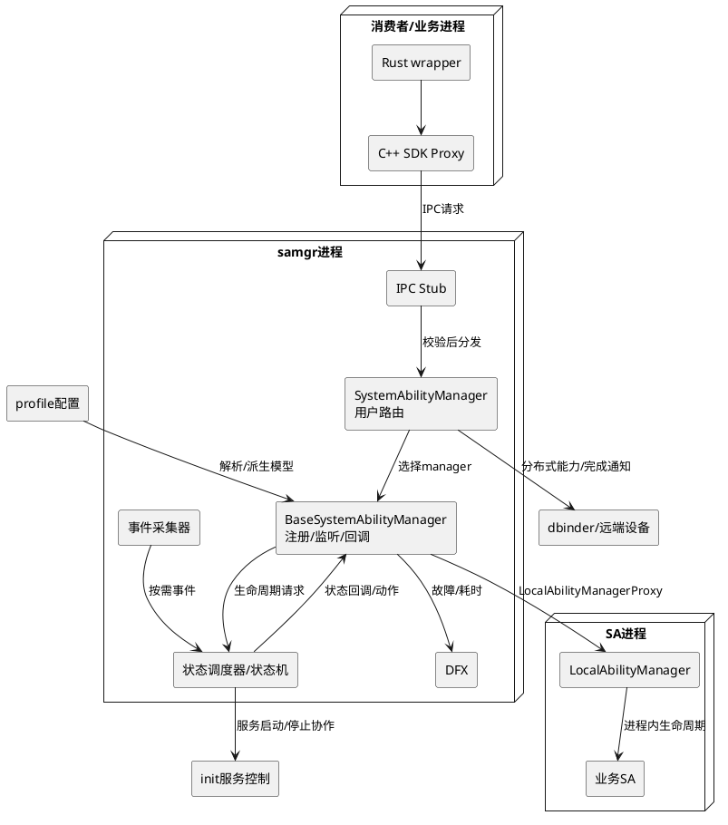

# 业务背景

本文按当前代码说明系统服务管理部件samgr，源码基线为 `be5bcff16fa94dfdb4c1d482f8877899dc7e8dab`。所有源码路径从仓根解析，生成日期2026-11-05。阅读顺序：[术语](glossary.md) → [架构](architecture.md) → [业务实体](samgr-Entity.md) → [技术机制](samgr-Technology.md)；修改实现前查阅[编码约束](coding-standards.md)。

## 应用定位

### 核心职责
samgr是OpenHarmony标准系统中的系统服务登记、发现及生命周期协调组件。消费者以SA ID查询远程对象；服务进程通过登记能力与进程对象参与管理；按需事件和接口调用触发加载/卸载，调度器协调SA与进程状态。多实例配置开启后，还需将调用路由到相应用户manager。

| 业务能力 | 主要职责 | 实现入口 |
|---|---|---|
| 登记和发现 | 保存服务对象、查询和枚举；注册替换、移除与缓存失效 | BaseSystemAbilityManager及SDK Proxy |
| 按需生命周期 | 接收加载/卸载/取消、保存请求、调度状态、通知结果 | BaseSystemAbilityManager、SystemAbilityStateScheduler |
| 能力与进程监听 | 维护订阅、死亡通知、计数和解除关系 | SAListener、DeathRecipient及调度器进程订阅 |
| 配置与事件策略 | 解析profile、匹配参数/公共事件/定时/引用事件 | ParseUtil、DeviceStatusCollectManager |
| 用户与设备范围 | 用户manager路由、用户激活停止、分布式能力桥接 | UserLifecycleManager、RpcCallbackImp |
| SDK和观测 | C++/Rust访问、动态查询缓存、日志/事件/dump | samgr_proxy、samgr_rust、DynamicCache及DFX |

源码依据：`interfaces/innerkits/samgr_proxy/include/if_system_ability_manager.h`、`services/samgr/native/source/base_system_ability_manager.cpp`、`services/samgr/native/source/system_ability_manager.cpp`，组件适用系统在 `bundle.json` 的 `adapted_system_type` 中声明为standard。

### 职责边界（本组件不负责）
- 不实现业务SA内部功能，也不根据业务头文件直接操作具体SA，交互依赖IRemoteObject及ID。
- 不独立完成业务库初始化和销毁；进程内LocalAbilityManager/safwk接收Start/Stop/Idle/Active等操作，业务执行结果需要下游材料证实。
- 不替代系统IPC传输、AccessToken/SELinux基础设施和init服务控制；本仓在相应边界调用或检查。
- 不实现dbinder传输协议本体及设备发现基础设施，只管理分布式能力和加载桥接。
- 不执行硬件驱动或寄存器操作；SA查询为空、加载失败不能直接归为驱动故障。

## 系统上下文

图中双向协调不表示所有路径都同步执行。真实并发由各表的锁、FFRTHandler和调度上下文共同约束。

## 核心输入
1. SDK查询、登记、订阅、加载、卸载和扩展查询请求，包含said、回调、对象、设备ID及部分重载的用户ID。
2. SA进程登记的能力对象与LocalAbilityManager对象，用于后续发现和进程内控制。
3. JSON profile：所属进程、库、依赖、启动阶段、按需事件、回收与重启策略等；解析规则以ParseUtil为准。
4. 参数、网络、公共事件、开关、定时和引用事件；部分插件受构建宏控制。
5. IPC死亡通知及用户状态变更；它们影响注册表、等待回调、订阅关系与manager生命周期。

## 核心输出
1. 查询返回的远程对象、整型受理返回和异步加载完成通知；这三类结果含义不同。
2. 服务添加/移除及进程状态通知；通知失败不等价于注册表没有改变。
3. 发送到LocalAbilityManager及init边界的生命周期动作，实际业务是否完成需结合下游结果。
4. 分布式加载完成通知及缓存失效信号。
5. SAMGR日志、HiSysEvent、HiTrace、dump/统计及watchdog观测信息。命令与测试本次均未运行。
