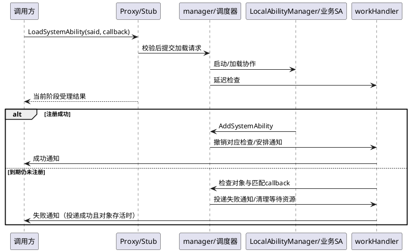

# 技术术语知识

本文按主要机制说明Problem、Principles、Usage、Code和Constraints；所有源码路径从仓根解析。用于理解与修改代码，未执行构建或实机验证。

## 启动发布与profile派生

### 解决的问题（Problem）
| 子维度 | 内容 |
|---|---|
| 业务痛点 | 客户端需要先找到管理入口，各运行模块还需一致的能力配置。 |

### 原理（Principles）
| 子维度 | 内容 |
|---|---|
| 核心机制与流程 | main取得单例并Init；Base建立死亡监听、work/death handler、collector和scheduler，再InitSaProfile。main随后SetContextObject、AddSamgrToAbilityMap、写bootevent.samgr.ready、启动DFX并JoinWorkThread。ParseUtil只接受所实现的JSON路径/结构，校验process等字段；完整SaProfile被派生为manager/采集用途模型。 |

### 使用方式（Usage）
| 子维度 | 内容 |
|---|---|
| 调用与修改方式 | 启动时先确认配置解析和各manager初始化，再确认context发布与ready写入。新增配置字段同时追踪完整profile与派生视图，不能只修改SaProfile声明。 |

### 代码关联（Code）
| 子维度 | 内容 |
|---|---|
| 核心入口 | `services/samgr/native/source/main.cpp` 中的 `main` |
| 关联实现/定义 | `services/common/src/parse_util.cpp` 中的 `ParseJsonFile` |

### 约束与限制（Constraints）
| 子维度 | 内容 |
|---|---|
| 实现边界 | SetContextObject失败日志和ready参数不是同一成功条件；ready被写入不能证明所有更早操作成功。跨仓库装载由实际调用方完成，不能因ParseUtil提供OpenSo就断言samgr总在自身进程加载业务库。 |

## IPC分发、身份与分层返回

### 解决的问题（Problem）
| 子维度 | 内容 |
|---|---|
| 业务痛点 | 同一业务接口会在客户端、传输、服务校验及异步完成阶段失败，必须保留层次。 |

### 原理（Principles）
| 子维度 | 内容 |
|---|---|
| 核心机制与流程 | Proxy校验参数并写token/参数；OnRemoteRequest先EnforceInterceToken，再通过memberFuncMap_分发。具体交易继续执行ID、权限及配置条件检查，然后调用manager。descriptor OHOS.ISystemAbilityManager与交易token ohos.samgr.accessToken是不同常量。 |

### 使用方式（Usage）
| 子维度 | 内容 |
|---|---|
| 调用与修改方式 | 新增交易同步声明、IPC码、Proxy、Stub、实现、权限和绑定。加载非法输入在Proxy可能ERR_INVALID_VALUE，在Base为INVALID_INPUT_PARA；用调用层解释错误，而不是只查枚举。 |

### 代码关联（Code）
| 子维度 | 内容 |
|---|---|
| 核心入口 | `services/samgr/native/source/system_ability_manager_stub.cpp` 中的 `OnRemoteRequest` |
| 关联实现/定义 | `interfaces/innerkits/samgr_proxy/include/if_system_ability_manager.h` 中的 `SAMANAGER_INTERFACE_TOKEN` |

### 约束与限制（Constraints）
| 子维度 | 内容 |
|---|---|
| 实现边界 | 统一token通过不等于业务授权通过；SELinux/PengLai等受构建与运行条件影响。公共ID校验含0，不能把根导航的简写范围套给每个方法。 |

## 注册、覆盖、查询与主动移除

### 解决的问题（Problem）
| 子维度 | 内容 |
|---|---|
| 业务痛点 | 消费者需要按ID发现远程对象，同时注册替换/移除必须协调缓存、状态和通知。 |

### 原理（Principles）
| 子维度 | 内容 |
|---|---|
| 核心机制与流程 | Add在校验和分布式属性核对后，锁内查容量并写SAInfo；覆盖时处理缓存和移除通知。锁外撤加载检查、处理注册完成、挂death并发状态/添加通知。Check读表返回对象或空。主动Remove擦表、解绑death后再失效缓存并发卸载成功状态与移除通知。 |

### 使用方式（Usage）
| 子维度 | 内容 |
|---|---|
| 调用与修改方式 | 只需要存在性时用Check；Get与带isExist重载另有等待/按需语义，不能全部视为只读查表。错误后重试前观察注册表和已发通知。 |

### 代码关联（Code）
| 子维度 | 内容 |
|---|---|
| 核心入口 | `services/samgr/native/source/base_system_ability_manager.cpp` 中的 `AddSystemAbility` |
| 关联实现/定义 | `services/samgr/native/source/base_system_ability_manager.cpp` 中的 `RemoveSystemAbility` |

### 约束与限制（Constraints）
| 子维度 | 内容 |
|---|---|
| 实现边界 | 容量检查先于覆盖分支，满表不能假定覆盖必成功；scheduler空等晚期错误可能发生在写表/erase之后。空对象可能是输入、权限、路由或未注册，不能直接证明进程崩溃。 |

## 加载请求、超时与回调额度回收

### 解决的问题（Problem）
| 子维度 | 内容 |
|---|---|
| 业务痛点 | 按需启动跨越请求、进程、注册和回调多个阶段，需要限制等待资源并清理失败请求。 |

### 原理（Principles）
| 子维度 | 内容 |
|---|---|
| 核心机制与流程 | Base先检查输入/profile/scheduler，再交HandleLoadAbilityEvent。DoLoad对象已存在时安排通知；未存在则onDemandLock_内去重、检查PID额度、保存callback、启动进程并SendCheckLoadedMsg。延迟检查若查到对象就返回，否则CleanCallbackForLoadFailed按设备和AsObject匹配，投递LOAD_SA_TIMEOUT失败通知，并解绑death/递减原PID计数。注册会撤销相应检查任务。 |

### 使用方式（Usage）
| 子维度 | 内容 |
|---|---|
| 调用与修改方式 | callback重载返回受理结果，等待OnLoadSystemAbilitySuccess/Fail解释最终结果。同PID累计上限常量MAX_SUBSCRIBE_COUNT=256，但订阅计数和callback计数是两张表。 |

### 代码关联（Code）
| 子维度 | 内容 |
|---|---|
| 核心入口 | `services/samgr/native/source/base_system_ability_manager.cpp` 中的 `DoLoadSystemAbility` |
| 关联实现/定义 | `services/samgr/native/source/base_system_ability_manager.cpp` 中的 `CleanCallbackForLoadFailed` |

### 约束与限制（Constraints）
| 子维度 | 内容 |
|---|---|
| 实现边界 | 通知投递失败与额度已释放可同时发生；不要认为回收就表示消费者收到通知。重复对象检查早于限额。超时、callback死亡、迟到注册及任务取消存在竞争，静态顺序不能替代竞争测试。 |

## 状态机守卫与SA/进程计数

### 解决的问题（Problem）
| 子维度 | 内容 |
|---|---|
| 业务痛点 | 注册表仅能回答对象是否存在，不能表达加载中、可卸载、停止中及待处理事件。 |

### 原理（Principles）
| 子维度 | 内容 |
|---|---|
| 核心机制与流程 | 调度器维护两类上下文；事件处理器将事件映射到状态机。AbilityStateTransitionLocked校验context/目标handler、幂等相同状态、执行CanEnter，再UpdateStateCount，之后写state并OnEnter。LOADING允许从NOT_LOADED进入；LOADED允许从NOT_LOADED/LOADING/UNLOADABLE进入；UNLOADABLE从LOADED，UNLOADING从UNLOADABLE。 |

### 使用方式（Usage）
| 子维度 | 内容 |
|---|---|
| 调用与修改方式 | 新增状态或事件同时审查handler注册、守卫、状态计数初始化、事件映射、OnEnter动作及测试。诊断记录当前/目标状态和所属进程计数，不能只手动改state。 |

### 代码关联（Code）
| 子维度 | 内容 |
|---|---|
| 核心入口 | `services/samgr/native/source/schedule/system_ability_state_machine.cpp` 中的 `AbilityStateTransitionLocked` |
| 关联实现/定义 | `services/samgr/native/source/schedule/system_ability_state_machine.cpp` 中的 `UpdateStateCount` |

### 约束与限制（Constraints）
| 子维度 | 内容 |
|---|---|
| 实现边界 | UpdateStateCount要求进程上下文与计数槽存在、旧状态数大于0；失败时不能跳过检查。进程NOT_STARTED/STARTED/STOPPING与SA五态分开，同进程多个SA共享进程级协调。 |

## 空闲、卸载与取消卸载

### 解决的问题（Problem）
| 子维度 | 内容 |
|---|---|
| 业务痛点 | 释放按需能力资源时要兼顾所属进程、空闲时机及新的加载请求。 |

### 原理（Principles）
| 子维度 | 内容 |
|---|---|
| 核心机制与流程 | Unload先查profile、校验调用进程，再构造INTERFACE_CALL/unload请求交调度器。状态上下文保存待卸载与实际卸载请求；可卸载状态、延迟事件与LocalAbilityManager的Idle/Stop动作共同推进。CancelUnload为单独入口，不能视作普通Remove。主动Remove后发卸载成功事件。 |

### 使用方式（Usage）
| 子维度 | 内容 |
|---|---|
| 调用与修改方式 | Unload的ERR_OK按接口说明不代表对象已经移除。确认请求、空闲/卸载状态、下游动作和最终remove时间线；取消时还要考虑新请求与已执行动作。 |

### 代码关联（Code）
| 子维度 | 内容 |
|---|---|
| 核心入口 | `services/samgr/native/source/base_system_ability_manager.cpp` 中的 `UnloadSystemAbility` |
| 关联实现/定义 | `services/samgr/native/source/base_system_ability_manager.cpp` 中的 `CancelUnloadSystemAbility` |

### 约束与限制（Constraints）
| 子维度 | 内容 |
|---|---|
| 实现边界 | 不是每个SA卸载都停止整个进程；profile进程归属检查失败可返回INVALID_CALL_PROC。实际延迟来源和独立卸载策略需随配置与状态路径确认，不能以一个固定超时覆盖所有阶段。 |

## 死亡通知分流与引用清理

### 解决的问题（Problem）
| 子维度 | 内容 |
|---|---|
| 业务痛点 | 服务、进程、订阅者和加载回调的死亡影响不同对象，统一删除会破坏状态。 |

### 原理（Principles）
| 子维度 | 内容 |
|---|---|
| 核心机制与流程 | AbilityDeathRecipient调用remote对象RemoveSystemAbility并走崩溃/调度清理；SystemProcessDeathRecipient移除进程；AbilityStatusDeathRecipient按支持条件同步或异步解除监听；AbilityCallbackDeathRecipient调用OnAbilityCallbackDied，遍历said和设备组清匹配callback；远程callback和进程监听也有独立recipient。 |

### 使用方式（Usage）
| 子维度 | 内容 |
|---|---|
| 调用与修改方式 | 检查死的是哪个对象及对应AsObject、原PID和时间，再检查相应关系是否移除。新增长期持有引用需同时设计death与主动解除。 |

### 代码关联（Code）
| 子维度 | 内容 |
|---|---|
| 核心入口 | `services/samgr/native/source/ability_death_recipient.cpp` 中的 `AbilityStatusDeathRecipient` |
| 关联实现/定义 | `services/samgr/native/source/base_system_ability_manager.cpp` 中的 `OnAbilityCallbackDied` |

### 约束与限制（Constraints）
| 子维度 | 内容 |
|---|---|
| 实现边界 | 不能用SA移除日志证明listener额度已回收；异步解除用于特定死亡通知路径。manager弱引用、常驻单例与Multi manager销毁语义须结合实际持有模型核查。 |

## 按需事件采集与策略匹配

### 解决的问题（Problem）
| 子维度 | 内容 |
|---|---|
| 业务痛点 | 能力的启动/停止还可能由系统状态变化触发，需要把配置事件映射为控制动作。 |

### 原理（Principles）
| 子维度 | 内容 |
|---|---|
| 核心机制与流程 | DeviceStatusCollectManager先过滤没有start/stop事件的profile，建立collectHandler_及插件映射后StartCollect。PARAM、TIMED_EVENT、UNREF_EVENT等各有插件；网络/公共事件/开关受SUPPORT_DEVICE_MANAGER、SUPPORT_COMMON_EVENT、SUPPORT_SWITCH_COLLECT宏控制。事件经过条件匹配生成SaControlInfo列表，进入按需处理。 |

### 使用方式（Usage）
| 子维度 | 内容 |
|---|---|
| 调用与修改方式 | 新增事件需同时检查解析、事件ID/条件、插件初始化和映射、监听、匹配、启动/停止调度及解除。公共事件额外数据、持久定时与一次性事件按各自实现处理。 |

### 代码关联（Code）
| 子维度 | 内容 |
|---|---|
| 核心入口 | `services/samgr/native/source/collect/device_status_collect_manager.cpp` 中的 `Init` |
| 关联实现/定义 | `interfaces/innerkits/common/include/sa_profiles.h` 中的 `OnDemandEvent` |

### 约束与限制（Constraints）
| 子维度 | 内容 |
|---|---|
| 实现边界 | profile声明某种事件不证明当前产品有插件；事件来源未采集、条件不匹配和调度失败要分开。不要仅因OnDemandEvent.operator==为真就认为conditions/extraMessages等全相同。 |

## 多实例路由、用户激活与停止

### 解决的问题（Problem）
| 子维度 | 内容 |
|---|---|
| 业务痛点 | 不同用户的同一SA可能需要独立实例，停止期间还要避免新请求进入旧manager。 |

### 原理（Principles）
| 子维度 | 内容 |
|---|---|
| 核心机制与流程 | SUPPORT_MULTI_INSTANCE开启后，RouteForUser对普通SA走BASE_USER；多实例SA由base调用者路由前台用户，其他调用者路由自己。激活以用户生命周期锁协调，初始化Multi manager并与全局订阅快照协作后发布。停止先从validUserIds_与multiUserManagers_移除，更新前台，再进入等待/超时完成；CompleteUserStopping防重复完成，等待进程停止、必要时STOP，然后停止采集并Destroy。 |

### 使用方式（Usage）
| 子维度 | 内容 |
|---|---|
| 调用与修改方式 | 诊断同said的不同结果需记录caller/target/前台和用户状态。显式userId接口限定调用者/目标条件，不等同隐式路由；全用户订阅还涉及回滚。 |

### 代码关联（Code）
| 子维度 | 内容 |
|---|---|
| 核心入口 | `services/samgr/native/source/system_ability_manager.cpp` 中的 `RouteForUser` |
| 关联实现/定义 | `services/samgr/native/source/user_lifecycle_manager.cpp` 中的 `CompleteUserStopping` |

### 约束与限制（Constraints）
| 子维度 | 内容 |
|---|---|
| 实现边界 | 停止未完成但目标manager不可路由可能是预期窗口。不能把一个manager的表或额度推成系统全局；默认GN开关为false不表示实际产品一定关闭。 |

## 跨设备能力和RPC加载桥接

### 解决的问题（Problem）
| 子维度 | 内容 |
|---|---|
| 业务痛点 | 远端请求既要识别分布式能力，也要把本地加载的异步结果回送正确设备。 |

### 原理（Principles）
| 子维度 | 内容 |
|---|---|
| 核心机制与流程 | RpcCallbackImp向SystemAbilityManager转发GetSystemAbilityFromRemote、IsDistributedSystemAbility和远端加载。LoadSystemAbilityFromRemote保存srcNetworkId于LoadCallbackImp，交LoadSystemAbilityFromRpc；成功回调NotifyRpcLoadCompleted传对象，失败传nullptr。远程callback管理与本地等待设备分组共同参与清理。 |

### 使用方式（Usage）
| 子维度 | 内容 |
|---|---|
| 调用与修改方式 | 按said、来源设备、回调和时间线关联本地加载与RPC完成；检查profile分布式属性及dbinder初始化配置。 |

### 代码关联（Code）
| 子维度 | 内容 |
|---|---|
| 核心入口 | `services/samgr/native/source/rpc_callback_imp.cpp` 中的 `LoadSystemAbilityFromRemote` |
| 关联实现/定义 | `services/samgr/native/source/rpc_callback_imp.cpp` 中的 `NotifyRpcLoadCompleted` |

### 约束与限制（Constraints）
| 子维度 | 内容 |
|---|---|
| 实现边界 | 设备ID日志采用匿名化工具；不能以一个本地查询成功证明远端链路成功。传输、远端权限与设备生命周期属于外部边界，需要两侧证据。 |

## 动态查询缓存及失效信号

### 解决的问题（Problem）
| 子维度 | 内容 |
|---|---|
| 业务痛点 | 频繁查找服务会产生IPC；缓存必须同时判断注册变化和远端对象死亡。 |

### 原理（Principles）
| 子维度 | 内容 |
|---|---|
| 核心机制与流程 | DynamicCache::QueryResult读取参数水位；CanUseCache要求已有本地水位、同said、水位非default且一致、缓存对象非空且未死亡。不命中则Recompute；仅非空结果写回缓存，先解绑旧对象death再保存新对象并挂death。服务侧注册替换/移除调用SystemAbilityInvalidateCache。 |

### 使用方式（Usage）
| 子维度 | 内容 |
|---|---|
| 调用与修改方式 | 查询需区分缓存命中和真正服务侧查表；反复空对象不会按这段实现写成有效缓存。复核参数水位变化、对象death和实例最后查询的said。 |

### 代码关联（Code）
| 子维度 | 内容 |
|---|---|
| 核心入口 | `interfaces/innerkits/dynamic_cache/src/dynamic_cache.cpp` 中的 `CanUseCache` |
| 关联实现/定义 | `services/samgr/native/source/base_system_ability_manager.cpp` 中的 `SystemAbilityInvalidateCache` |

### 约束与限制（Constraints）
| 子维度 | 内容 |
|---|---|
| 实现边界 | 这是lastQuerySaId_/lastQuerySaProxy_单槽模型，不能描述成全部SA对象的永久map缓存。缓存锁是std::mutex，与服务端FFRT约束分属不同代码范围。 |

## Rust绑定与多语言接口一致性

### 解决的问题（Problem）
| 子维度 | 内容 |
|---|---|
| 业务痛点 | Rust消费者需要通过桥接访问相同服务语义，不能独立维护另一套SA约定。 |

### 原理（Principles）
| 子维度 | 内容 |
|---|---|
| 核心机制与流程 | lib.rs导出definition、manage、DumpFlagPriority并接入wrapper；cfg(multi_instance)控制多实例wrapper。manage封装使用接口，wrapper和src/cxx代码承接Rust/C++边界，最终接入C++ manager客户端。 |

### 使用方式（Usage）
| 子维度 | 内容 |
|---|---|
| 调用与修改方式 | 接口变更沿公开Rust API、桥接类型、C++实现、ID常量及BUILD配置检查；生成源/桥接文件性质按实际构建过程判断，遵守根AGENTS对派生输出的约束。 |

### 代码关联（Code）
| 子维度 | 内容 |
|---|---|
| 核心入口 | `interfaces/innerkits/rust/src/lib.rs` 中的 `manage` |
| 关联实现/定义 | `interfaces/innerkits/rust/src/manage.rs` 中的 `SystemAbilityManager` |

### 约束与限制（Constraints）
| 子维度 | 内容 |
|---|---|
| 实现边界 | 跨语言对象所有权与错误映射不能只由C++签名推断；不能把cfg关闭的接口当每个产品可用。具体桥接资源释放需随改动审查对应实现及Rust测试。 |

## 扩展筛选、诊断事件与阻塞观测

### 解决的问题（Problem）
| 子维度 | 内容 |
|---|---|
| 业务痛点 | 维护者既要按能力扩展属性发现服务，也要解释加载/卸载及进程耗时和失败。 |

### 原理（Principles）
| 子维度 | 内容 |
|---|---|
| 核心机制与流程 | Base扩展接口按profile.extension查ID，并结合运行表输出对象或SaExtensionInfo。DFX适配将SA/进程身份、事件与耗时形成HiSysEvent，SamgrXCollie保护关键阻塞点；dump与LocalAbilityManager统计命令提供服务和进程侧观察。 |

### 使用方式（Usage）
| 子维度 | 内容 |
|---|---|
| 调用与修改方式 | 扩展ID列表和运行对象列表分别解释；诊断时结合said、PID/用户、进程名、设备和时间，不用单条event确定下游责任。新增DFX需对照hisysevent.yaml并检查阈值逻辑。 |

### 代码关联（Code）
| 子维度 | 内容 |
|---|---|
| 核心入口 | `services/samgr/native/source/base_system_ability_manager.cpp` 中的 `GetExtensionSaIds` |
| 关联实现/定义 | `services/dfx/include/hisysevent_adapter.h` 中的 `ReportSaLoadDuration` |

### 约束与限制（Constraints）
| 子维度 | 内容 |
|---|---|
| 实现边界 | 计时起点/终点和上报阈值影响事件是否出现，没有事件不证明路径未执行。本次未运行设备命令，统计和dump的具体产品权限需实际环境确认。 |

### 加载完成与失败通知时序

图表达主要本地链，不将每次IPC返回、状态事件和通知任务的完成混为同一原子操作。投递失败、死亡、取消与迟到注册需分别查源码分支和测试。
